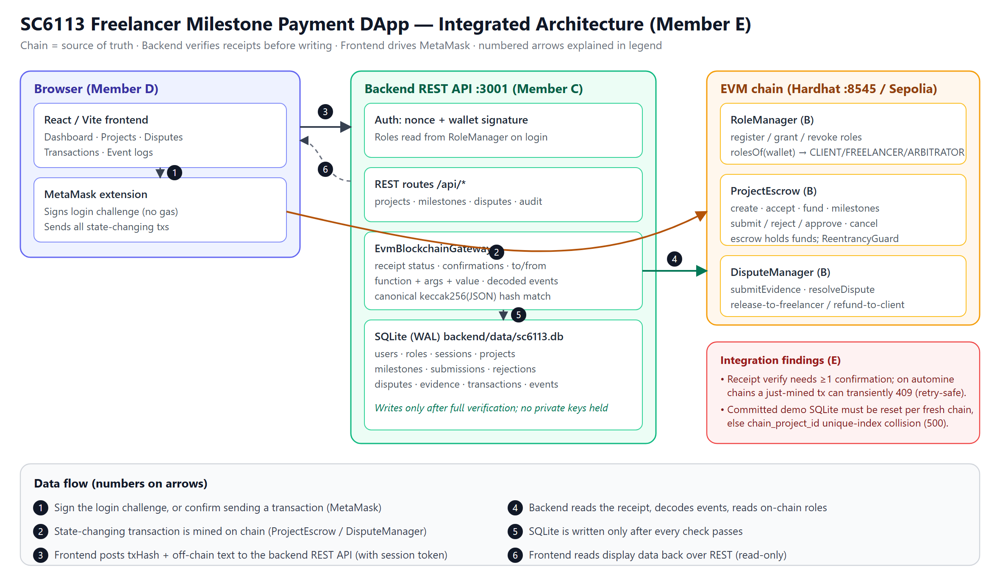
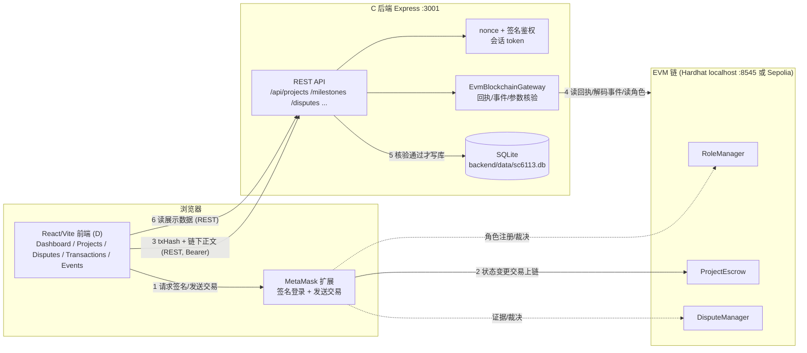

# SC6113 系统架构图与集成说明（Member E）

## 0. 架构图

> 图片来源：`docs/E-architecture.png`（位图，可直接插入 PPT/报告）与 `docs/E-architecture.svg`（矢量源）。图中编号箭头 1-6 的含义见底部 Data flow 图例，详细文字说明见下文 §2。

> 交付物：E「架构图」。
> 本文基于 D-integration 分支实际代码（contracts / backend / frontend）整理，非推测。

## 1. 组件与职责

| 组件 | 负责人 | 技术栈 | 职责 |
|---|---|---|---|
| 智能合约 `RoleManager` / `ProjectEscrow` / `DisputeManager` | B | Solidity 0.8.24 + Hardhat | 资金托管、角色、项目/里程碑/争议状态机的**最终依据**；所有资金变动只发生在链上 |
| 后端 REST API | C | TypeScript + Express 5 + node:sqlite | 钱包 nonce/签名登录、链下正文存储、**链上回执核验**（发送者/目标合约/函数/参数/金额/事件逐项比对）、SQLite 记录 |
| 数据库 | C | SQLite（`backend/data/sc6113.db`，WAL 模式） | 用户/角色/会话/项目/里程碑/提交/拒绝/争议/证据/交易/事件表；启动时自动建表迁移 |
| 前端 | D | React + Vite + ethers v6 + MetaMask | 三角色界面、发起 MetaMask 交易、交易确认后再把 `transactionHash` 与链下正文提交后端 |

## 2. 混合架构数据流（核心）

1. 前端通过 MetaMask 向 B 的合约发送交易（创建/接受/注资/提交/审批/争议/裁决…）。
2. 交易被挖出后，前端把 `transactionHash` + 链下正文（项目说明、提交 note、拒绝理由、争议描述、证据、裁决）发给 C 的 REST API。
3. 后端用 `EvmBlockchainGateway` 读取该哈希的回执，校验：回执存在且 status=1、确认数达标、`to` 是目标合约、`from` 等于登录钱包、函数名在白名单内、关键参数（含 keccak256 规范哈希）与请求体一致、`value` 与项目金额一致；再解码事件（如 `ProjectCreated`/`MilestoneAdded`/`DisputeRaised`）。
4. 全部通过才写 SQLite；任一不符返回 4xx 且**不写库**（因此对时序类 409 重试是安全的）。
5. 后端**不持有私钥、不代用户发交易**；登录签名不是链上交易、不耗 gas。

规范哈希约定（B/C/D 一致）：`keccak256(toUtf8Bytes(JSON.stringify(value)))`，属性声明顺序固定；日期用 `YYYY-MM-DD` 转 UTC 零点 unix 秒。

## 3. 架构图（Mermaid 源，GitHub 可直接渲染）

## 4. 关键设计点

- **链上是真相源**：金额、状态迁移、权限（`onlyClient`/`onlyFreelancer`/`onlyArbitrator`、ReentrancyGuard、pause）全部由合约强制；后端与前端只是记录与展示。
- **角色来自链上**：登录时后端读 `RoleManager.rolesOf(wallet)`，一个钱包可持多角色；未注册钱包在 nonce 步骤即 403。
- **链上 ID 与本地 ID 并存**：项目/里程碑/争议同时保存链上 ID（`chain_project_id` 等）与本地 UUID，事件表保存 block/txIndex/logIndex 便于溯源。
- **金额双存**：ETH 十进制字符串 + wei 字符串，避免浮点误差。
- **已知边界**：`GET /api/disputes` 不返回 `chainDisputeId`（前端与测试脚本从 `DisputeRaised` 事件/回执解析，与 D 的实现一致）；核验被拒时链上与库中状态会**故意**保持分叉（链上已发生、库中不记录），由业务后续动作（如 reject/重提交）收敛。

## 5. 相关既有图（B/C/D 产出，可直接引用）

- 合约交互图：`contracts/docs/diagrams/contract-interaction.svg`
- 正常支付时序：`contracts/docs/diagrams/normal-payment-sequence.svg`
- 争议时序：`contracts/docs/diagrams/dispute-sequence.svg`
- 项目/里程碑状态机：`contracts/docs/diagrams/project-state-machine.svg`、`milestone-state-machine.svg`
