# SC6113 Demo 手把手操作指南（纯小白版 · Member E）

这份指南假设你从没碰过 MetaMask 和区块链。每一步都写了：**点哪里 → 屏幕上会出现什么字 → 接下来做什么**。
每一步配了我用真实环境截的界面图（在 `docs/shots/` 文件夹里，下文直接显示）。
唯一截不到的是 **MetaMask 自己的弹窗**——它只出现在你自己的浏览器里，我用文字精确描述它长什么样、该点哪个按钮。

> 卡住了？任何一步和你的屏幕对不上，直接截屏发我，我带你走。

---

## 第 0 部分：先搞懂你要演示的东西（1 分钟）

这是一个"自由职业者按里程碑收款"的应用，有三个角色：

- **Client（甲方）**：创建项目、付钱进托管、验收付款、拒绝、取消
- **Freelancer（乙方）**：接项目、开工、提交成果、被拒后重交、提争议
- **Arbitrator（仲裁员）**：争议时二选一裁决（钱给乙方 / 退给甲方）

钱不是直接转的：甲方先把钱放进**链上托管合约**，乙方每完成一个里程碑、甲方点一次"验收"，钱才从托管里放一笔给乙方。所有钱的变动都发生在区块链上，后端只负责记录和核验。

你的电脑上跑着三个程序（下面第 1 部分启动它们）：

| 程序 | 地址 | 是干嘛的 |
|---|---|---|
| 本地区块链 | 127.0.0.1:8545 | 模拟的"链"，记账用 |
| 后端 | localhost:3001 | 记录与核验 |
| 前端网页 | localhost:5173 | 你操作、录屏的界面 |

---

## 第 1 部分：一次性准备（只做一次，约 10 分钟）

### 1.1 装 MetaMask 浏览器扩展（如果还没装）

1. 用 Chrome 或 Edge 打开 metamask.io，点 Download，安装扩展。
2. 第一次打开会让你创建钱包：设密码、备份助记词（随便设，这是本地测试钱包）。
3. **重要**：本演示只用本地测试币，绝不涉及真钱。

### 1.2 在 MetaMask 里添加"本地测试网络"

1. 点 MetaMask 扩展图标 → 左上角网络名下拉 → **Add network / 添加网络** → 手动添加（Add network manually）。
2. 逐字填这 4 项：

| 栏位 | 填什么 |
|---|---|
| Network name | `SC6113 Local`（随意） |
| RPC URL | `http://127.0.0.1:8545` |
| Chain ID | `31337` |
| Currency symbol | `ETH` |

3. 保存并切换到这个网络。**不切对网络，后面所有操作都会报"Wrong chain"。**

### 1.3 导入三个测试钱包（Client / Freelancer / Arbitrator）

这三个钱包是本地链自带的"演示账号"，私钥是公开写死在代码里的（仅本地可用）：

| 角色 | 账号 | 私钥（导入用） |
|---|---|---|
| Client 甲方 | #1 `0x7099...79c8` | `0x59c6995e998f97a5a0044966f0945389dc9e86dae88c7a8412f4603b6b78690d` |
| Freelancer 乙方 | #2 `0x3c44...93bc` | `0x5de4111afa1a4b94908f83103eb1f1706367c2e68ca870fc3fb9a804cdab365a` |
| Arbitrator 仲裁 | #3 `0x90f7...b906` | `0x7c852118294e51e653712a81e05800f419141751be58f605c371e15141b007a6` |

导入方法：MetaMask → 点右上角账户头像 → **Add account or hardware wallet** → **Import a new account / 私钥导入** → 粘贴上面私钥 → Import。三个都导一遍。之后点账户头像就能在三个钱包间切换。

### 1.4 启动三个程序（开 3 个 PowerShell 窗口，保持开着）

```powershell
# 窗口 1：本地链
cd D:\Documents\qwen-agent\ajBjhW5orS\default\SC6113\D-integration\contracts
npm run node

# 窗口 2：后端
cd D:\Documents\qwen-agent\ajBjhW5orS\default\SC6113\D-integration\backend
pnpm start

# 窗口 3：前端
cd D:\Documents\qwen-agent\ajBjhW5orS\default\SC6113\D-integration\frontend
npm run dev
```

**怎么算启动成功**：窗口 1 打印一长串 Account；窗口 2 打印 `SC6113 backend listening on http://localhost:3001` 和 `Blockchain gateway: evm`；窗口 3 打印 `Local: http://localhost:5173/`。
浏览器打开 `http://localhost:3001/health`，看到 `"chainMode":"evm"` 即后端正常。

> 如果后端报数据库错误或你想换一份干净的演示数据：停掉窗口 2，把 `backend\data` 整个文件夹改名（比如 `data-old`），再重新 `pnpm start` 即可自动重建。

---

## 第 2 部分：登录（Client 甲方）

1. 浏览器打开 `http://localhost:5173`。你会看到深色侧边栏 + 右上角蓝色按钮 **Connect MetaMask**：

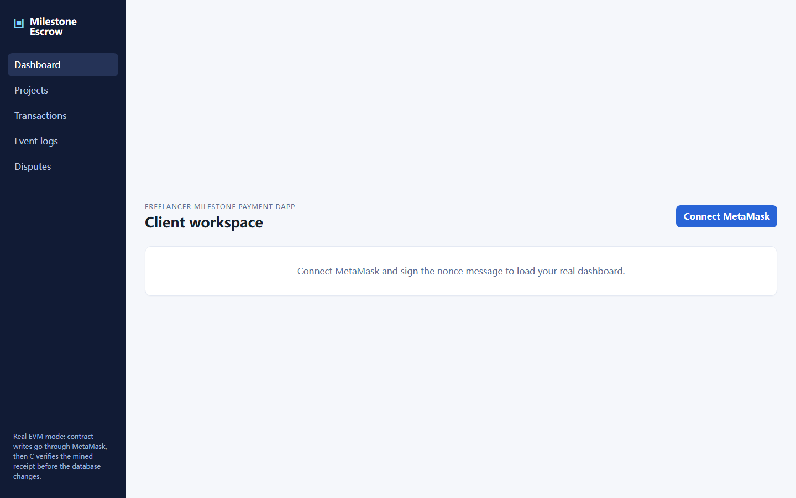

2. **先确认 MetaMask 当前选中的是 #1 Client 账户、网络是 SC6113 Local**（扩展图标里能看到）。
3. 点 **Connect MetaMask**。
   - 🔲 **MetaMask 弹窗 ①「连接请求」**：列出站点 localhost:5173 请求连接你的账户 → 点 **Connect / 连接**。
4. 按钮变成 **Sign in with wallet**，点它。
   - 🔲 **MetaMask 弹窗 ②「签名请求 Signature request」**：显示一段以 `SC6113 Freelancer Milestone Payment DApp` 开头的文字。**这是登录签名，不是转账、不花钱** → 点 **Sign / 签名**。
5. 按钮变成钱包地址缩写（如 `0x7099…79c8`），页面出现 **Client workspace** 和统计卡片：

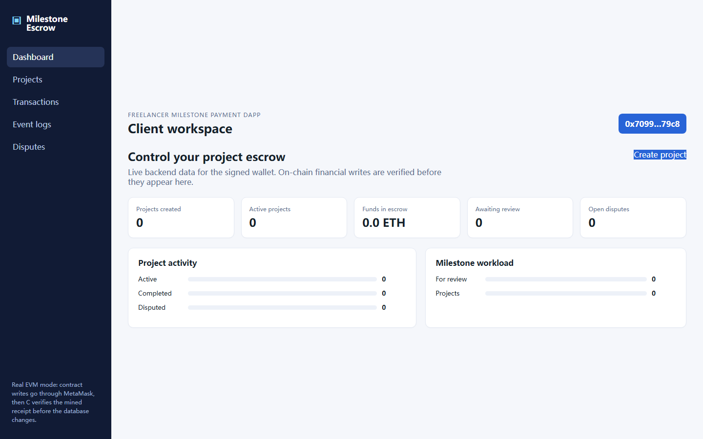

> 之后切换角色 = 在 MetaMask 里切换账户 → 回到网页点右上角钱包按钮 → 再走一次签名弹窗。

---

## 第 3 部分：创建项目（Client）

1. 点左侧 **Projects** → 点 **Create project**（或仪表盘上的 Create project）。
2. 按下面填（金额可改，但两个里程碑加起来必须等于总额）：

| 栏位 | 填 |
|---|---|
| Project title | `Demo Website` |
| Freelancer wallet address | `0x3C44CdDdB6a900fa2b585dd299e03d12FA4293BC`（乙方 #2） |
| Project description | `Landing page and logo for the demo store.` |
| Total payment (ETH) | `0.01` |
| Project deadline | 选一个未来日期 |
| Milestone 1 | Title `Design`、Amount `0.004`、Due 未来日期、Description `Logo and landing page design.` |
| 点 **+ Add milestone** 后 Milestone 2 | Title `Launch`、Amount `0.006`、Due 未来日期、Description `Production launch and handover.` |

填完长这样：

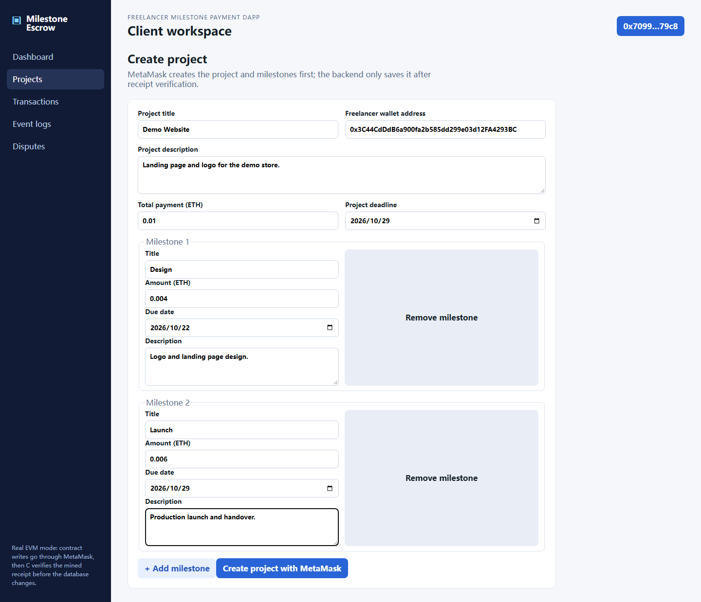

3. 点 **Create project with MetaMask**。
   - 🔲 **MetaMask 弹窗 ③「交易确认」**：显示 To: 合约地址、Amount: 0 ETH、Gas fee（测试币）→ 点 **Confirm / 确认**。
4. 网页按钮处会依次显示 `Transaction submitted… → Waiting for blockchain confirmation… → Recording and verifying with backend… → Recorded successfully.`，然后跳到项目详情页，右上角状态 **CREATED**：

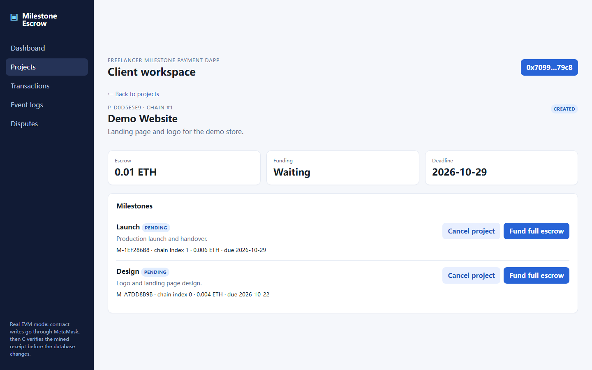

> 讲解点（录屏口播）：交易先上链，后端核验回执后才入库——所以下面每一步都是"先 MetaMask 确认、再看到网页状态变化"。

---

## 第 4 部分：乙方接项目（切到 Freelancer）

1. MetaMask 切到 **#2 Freelancer**。回网页点右上角钱包按钮 → 签名弹窗 → Sign。
2. 左侧 **Projects** → 点 **Demo Website** 进详情页 → 点 **Accept project**。
   - 🔲 MetaMask 交易确认弹窗 → Confirm。
3. 状态变 **ACCEPTED**：

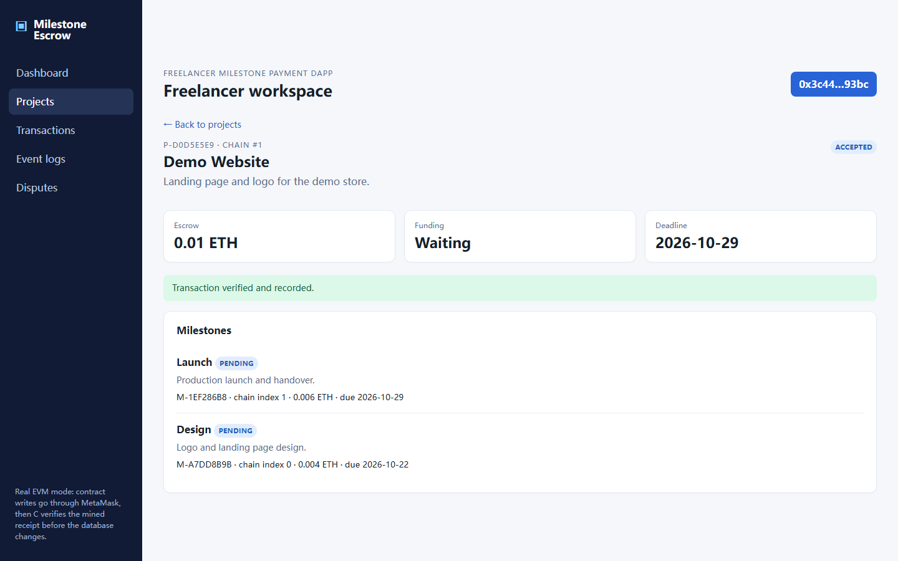

---

## 第 5 部分：甲方注资（切回 Client）

1. MetaMask 切回 **#1 Client**，网页重新签名登录，进 **Demo Website** 详情页。
2. 点 **Fund full escrow**。
   - 🔲 MetaMask 交易确认弹窗，这次 **Amount 显示 0.01 ETH**（钱进托管）→ Confirm。
3. 状态变 **ACTIVE**、Funding 变 **Deposited**：

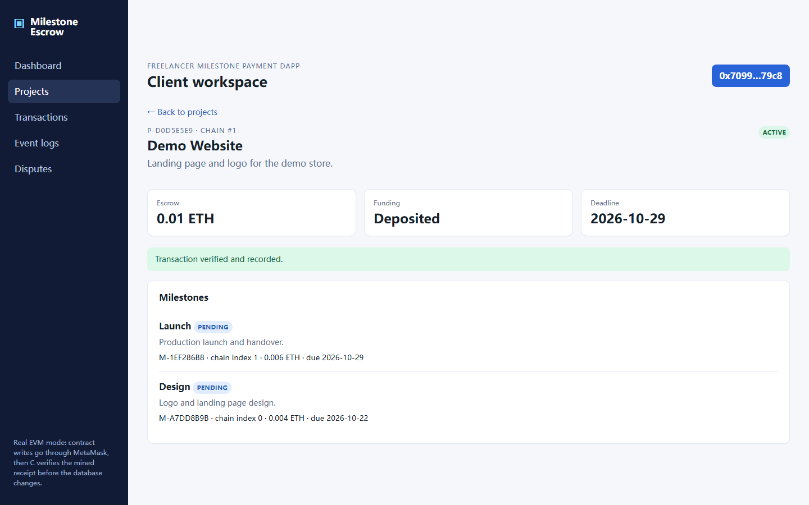

---

## 第 6 部分：里程碑 1 —— 开工、提交、验收付款

**乙方操作（#2）：**
1. 进项目详情页，对 Design 里程碑点 **Start milestone** → MetaMask Confirm → 状态 **IN PROGRESS**。
2. 点 **Submit milestone**，浏览器会弹出两个**输入框对话框**（这是网页自己的弹窗，不是 MetaMask）：
   - 第一个 `Submission note`：填 `Delivered logo pack and landing page mockups.` → 确定
   - 第二个 `Evidence URL (optional...)`：留空 → 确定
   - 然后 🔲 MetaMask 交易确认 → Confirm。
3. 状态 **SUBMITTED**，并能看到你填的 Submission 文字：

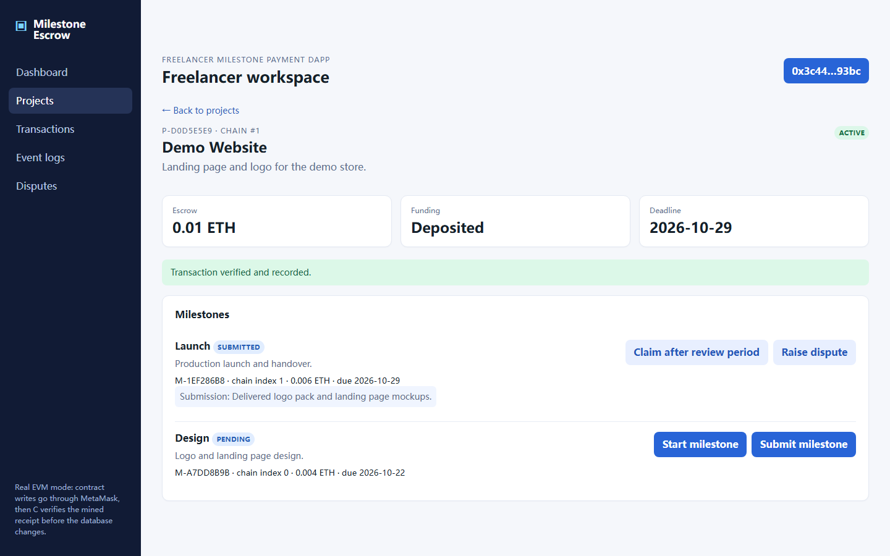

**甲方操作（#1）：**
4. 切回 #1 登录，进同一项目，对 Design 点 **Approve & release** → MetaMask Confirm。
5. 状态 **APPROVED**——这一刻链上把 0.004 ETH 付给了乙方（口播可提：可在 MetaMask 看 #2 余额增加）：

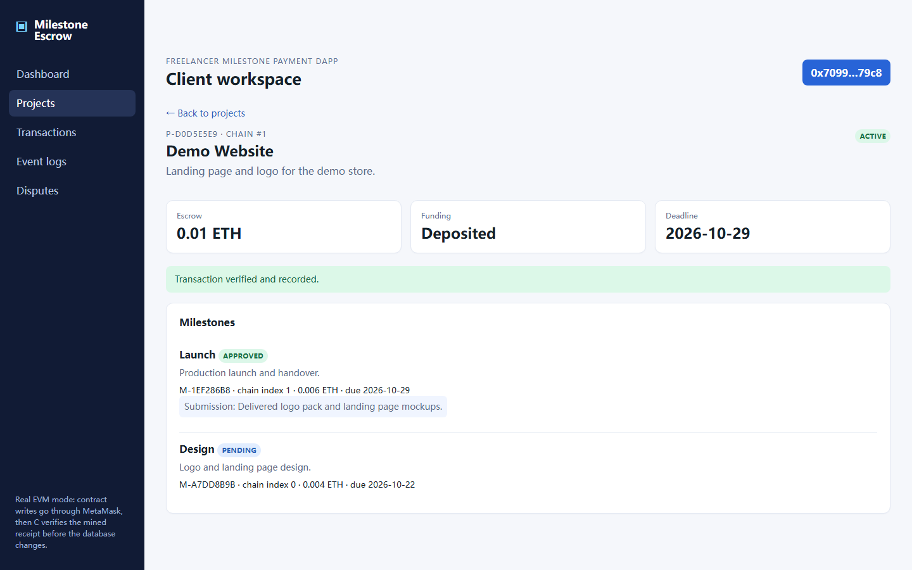

**里程碑 2 收尾：** 乙方对 Launch 点 Submit（note 填 `Launch package delivered.`）→ 甲方 Approve & release → 项目状态 **COMPLETED**、托管清零：

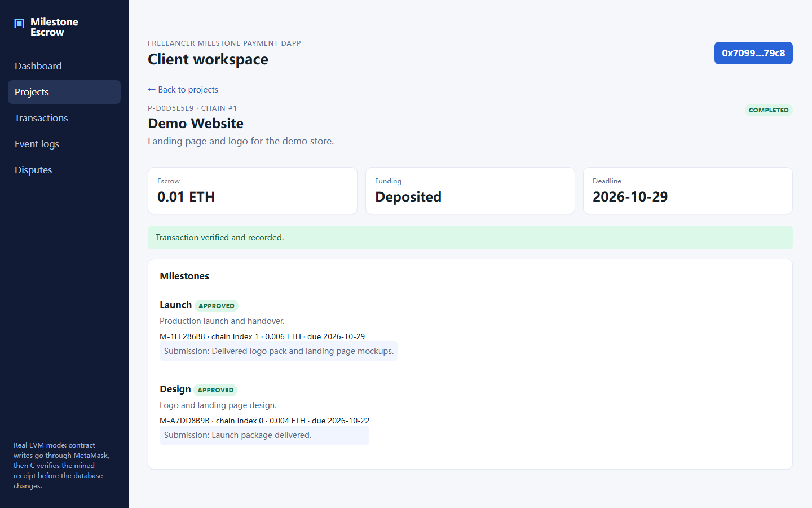

---

## 第 7 部分：争议全流程（演示"出问题怎么解决"）

需要第二个项目，重复第 3 部分创建一个（Title 改 `Demo Dispute Project`、总额 `0.005`、一个里程碑 `Backend API` `0.005`），然后乙方 Accept、甲方 Fund（同第 4、5 部分）。

1. **乙方提交**：Submit milestone，note 填 `First backend delivery.` → Confirm。
2. **甲方拒绝**：切 #1，点 **Reject**，弹窗 `Rejection reason` 填 `Missing authentication endpoints.` → 确定 → MetaMask Confirm → 状态 **REJECTED**：

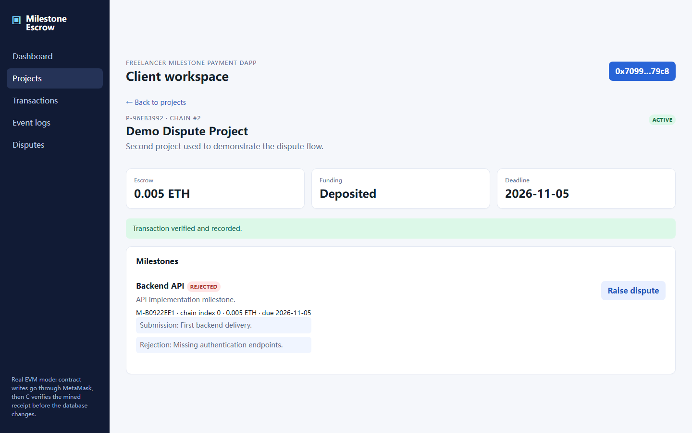

3. **乙方提争议**：切 #2，点 **Raise dispute**，弹窗 `Dispute description` 填 `Work was delivered per specification v2.` → 确定 → MetaMask Confirm → 项目状态 **DISPUTED**（资金冻结）：

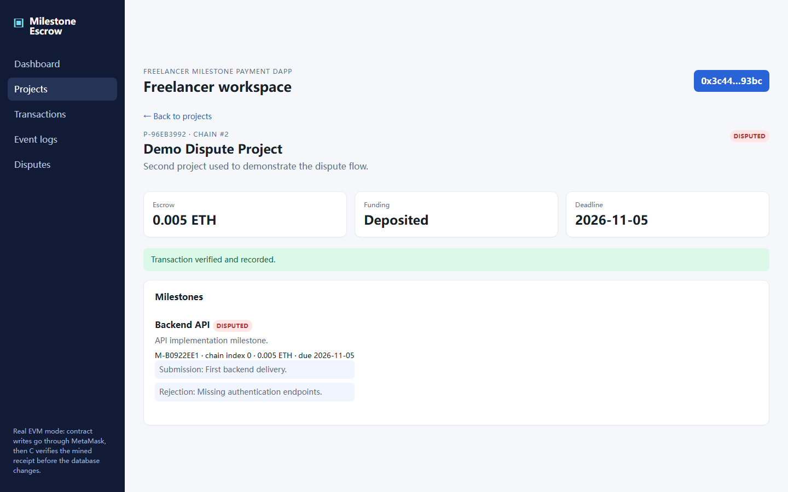

4. **乙方交证据**：左侧 **Disputes** → 对该争议点 **Submit evidence**，弹窗填 `Screenshot of delivered endpoints and passing tests.` → 确定 → MetaMask Confirm：

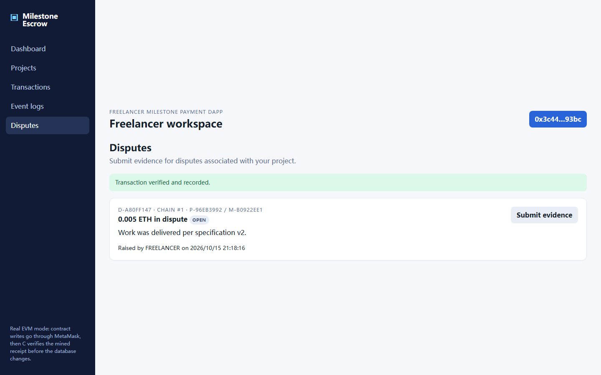

5. **仲裁员裁决**：MetaMask 切 **#3 Arbitrator**，网页签名登录 → 左侧 **Disputes** → 看到两个按钮：

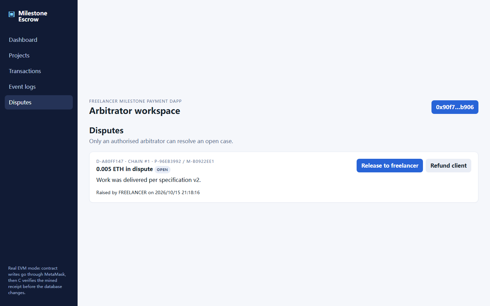

6. 点 **Release to freelancer**（钱给乙方；点 Refund client 则是退甲方，二选一讲一下）→ MetaMask Confirm → 状态 **RESOLVED**，显示 `Resolution: RELEASE_TO_FREELANCER`：

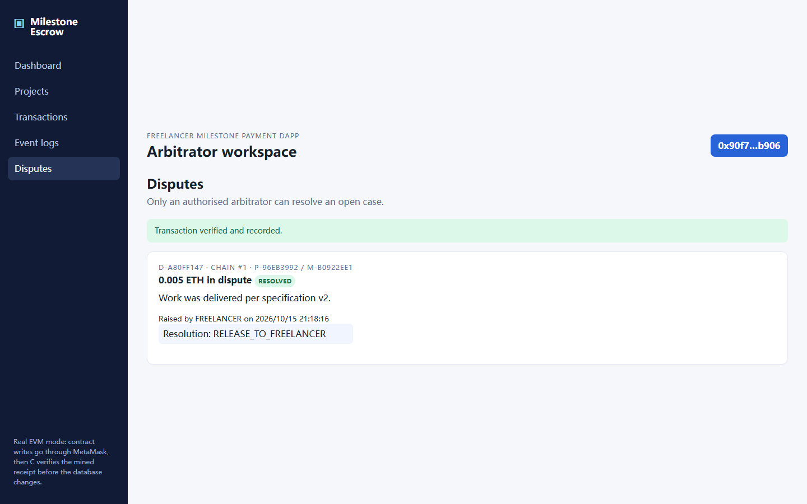

---

## 第 8 部分：展示"不是模拟数据"（审计页）

- **Projects** 列表：两个项目、本地 ID 与链上 ID（chain #）并列：

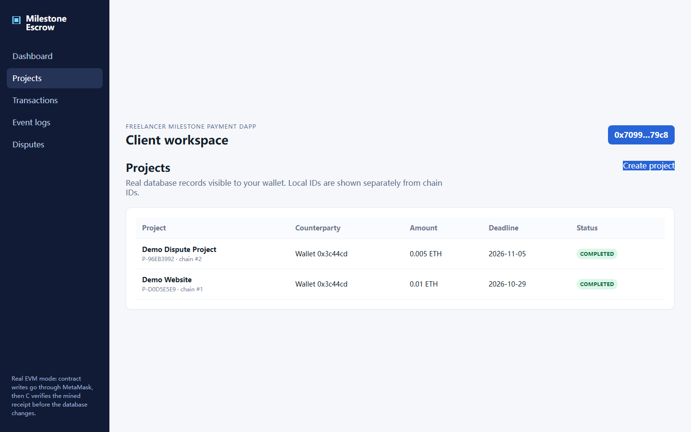

- **Transactions**：每笔链上交易（类型、钱包、金额、时间）：

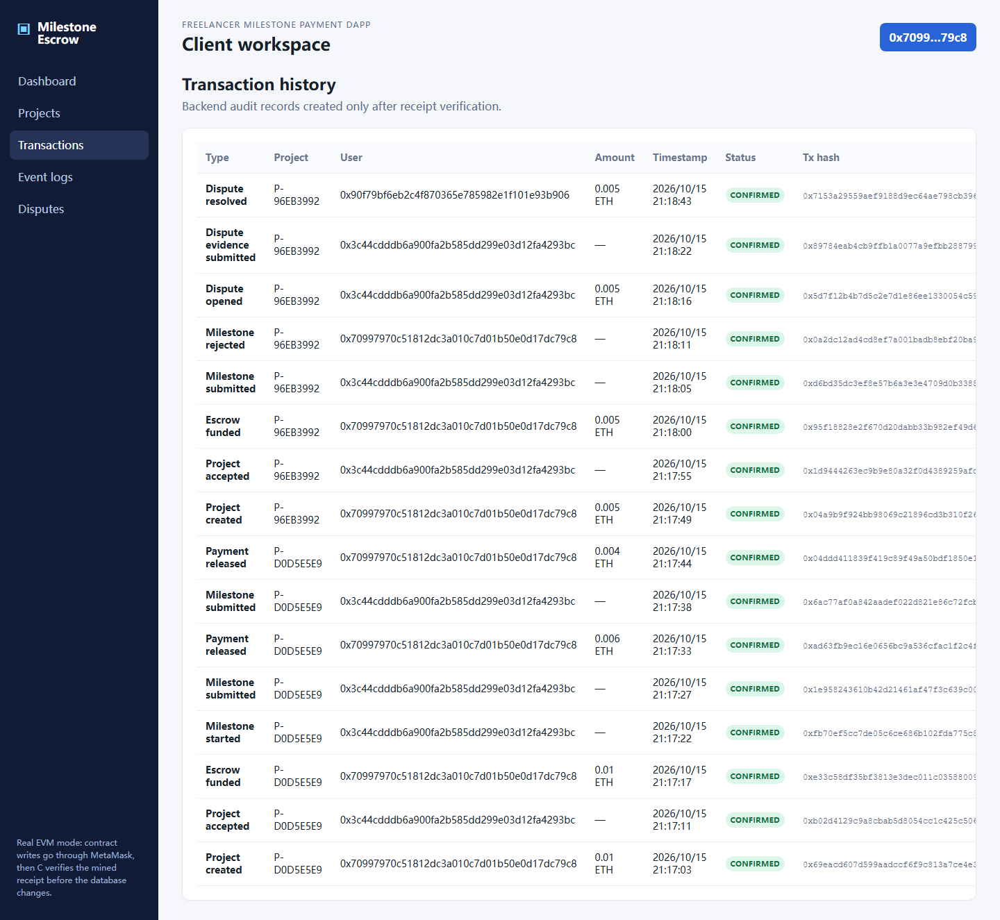

- **Event logs**：解码后的链上事件（ProjectCreated / ProjectFunded / MilestoneSubmitted / DisputeRaised / DisputeResolved…）：

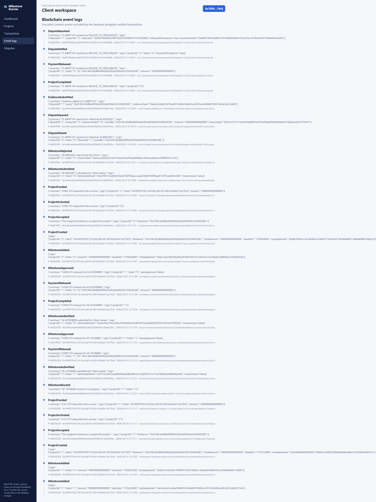

---

## 第 9 部分：卡住了怎么办（排错表）

| 你看到的 | 原因 | 怎么办 |
|---|---|---|
| 页面顶部红字 `Wrong chain...` | MetaMask 没切到 SC6113 Local | 扩展里切换网络到 Chain ID 31337 |
| 点 Connect 后红字 `This wallet must have an on-chain role...` | 当前钱包不是 #1/#2/#3 之一 | 切到三个演示账户之一 |
| MetaMask 弹窗一直转或报 nonce 错 | 链重启过，MetaMask 记着旧状态 | MetaMask → 设置 → 高级 → **Clear activity tab data / 清除活动数据**，重连重试 |
| 网页提示 `...confirmations are insufficient` 之类 | 后端区块缓存有约 4 秒延迟（已记录的集成发现 E-01） | 等几秒按页面提示重试一次即可；手动操作基本遇不到 |
| 创建项目报 `Milestone amounts must equal the total` | 里程碑加起来≠总额 | 改成相加等于总额 |
| 任何一步 MetaMask 报 gas/estimate 错 | 链或后端没在跑 | 检查第 1.4 的三个窗口是否都活着 |
| 想换干净数据重来 | 演示数据库里有旧项目 | 停后端 → 把 `backend\data` 文件夹改名 → 重新 `pnpm start` |

---

## 第 10 部分：录屏小贴士

- 顺序就按第 2→8 部分走，全程约 8-12 分钟；每个 MetaMask 弹窗停留 2 秒再点，让观众看清"先弹窗、后状态变化"。
- 口播三句话就够：① 钱在链上托管，不在任何一方手里；② 每笔状态变更都先经 MetaMask 上链、后端核验回执后才记录；③ 争议只能由仲裁员二选一裁决。
- 结尾展示第 8 部分三个页面，说明数据来自真实回执与事件解码。
- 截图文件夹 `docs/shots/` 里的 17 张图与本指南步骤一一对应，可直接剪进视频当转场图或备用。
