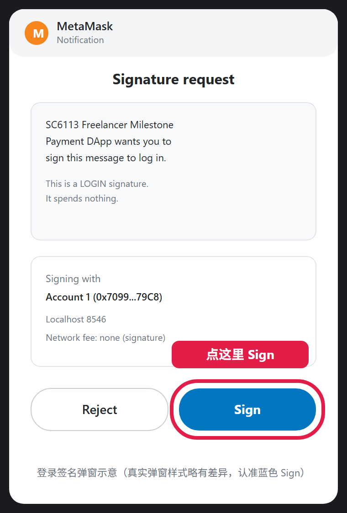
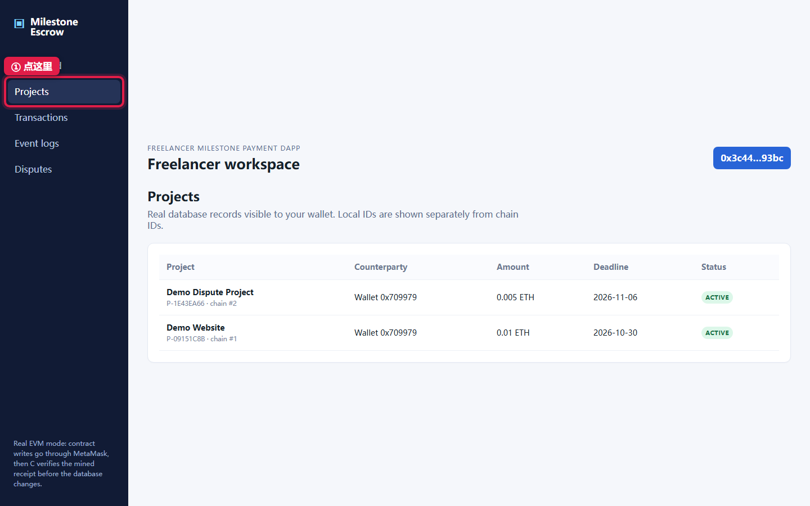
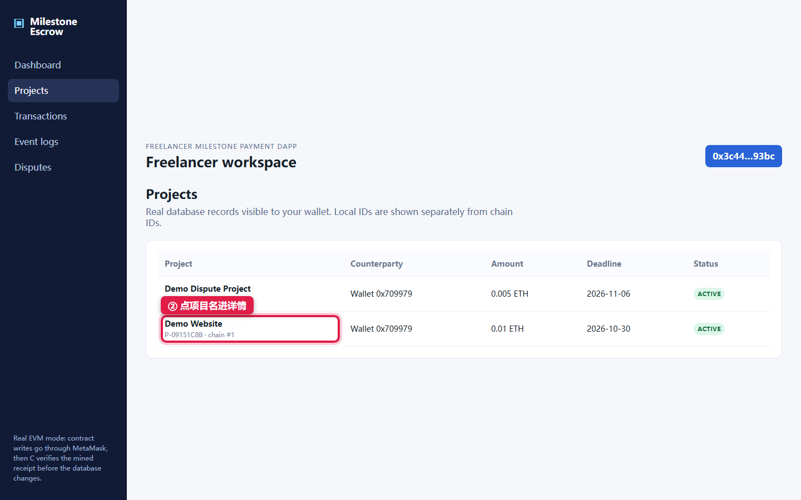
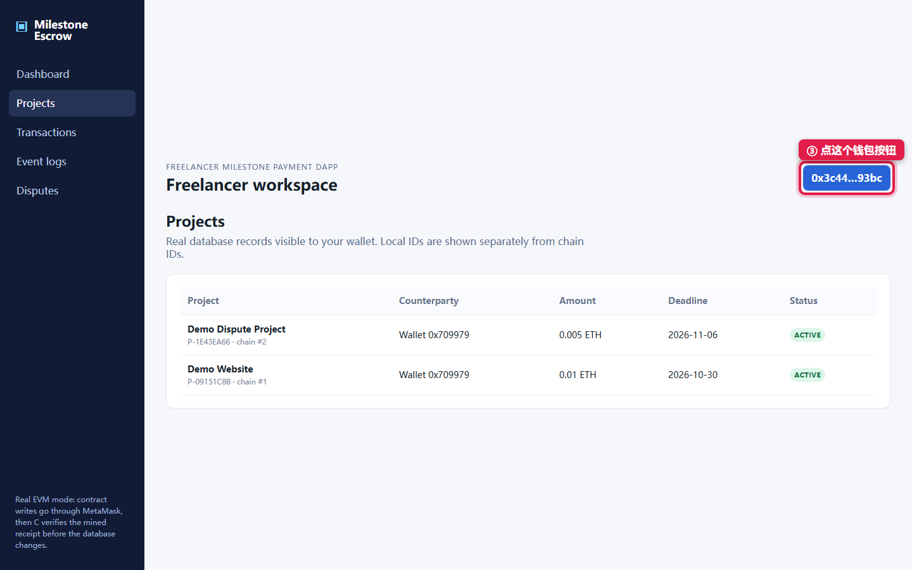
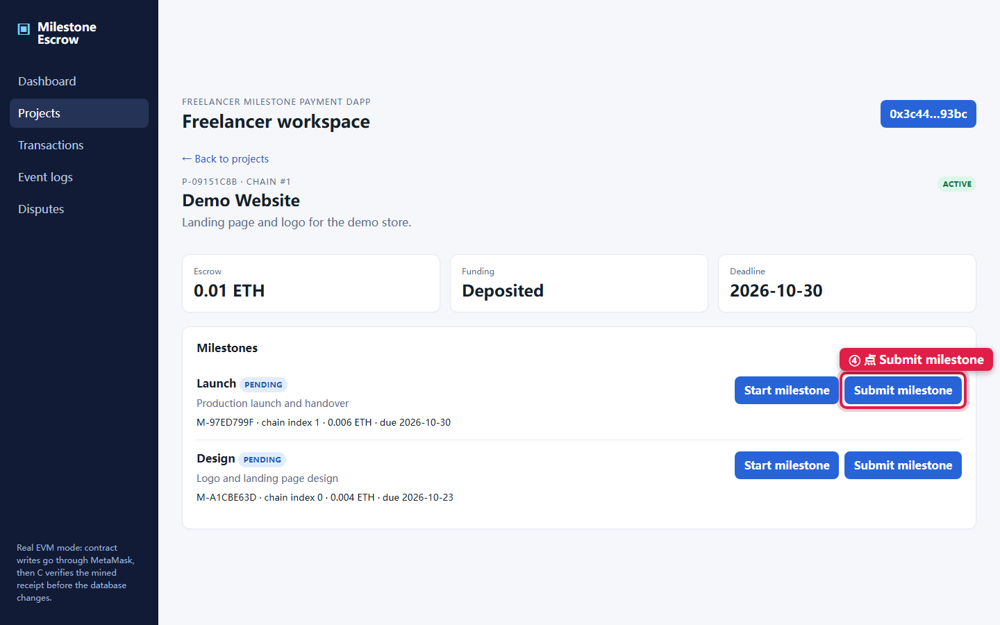
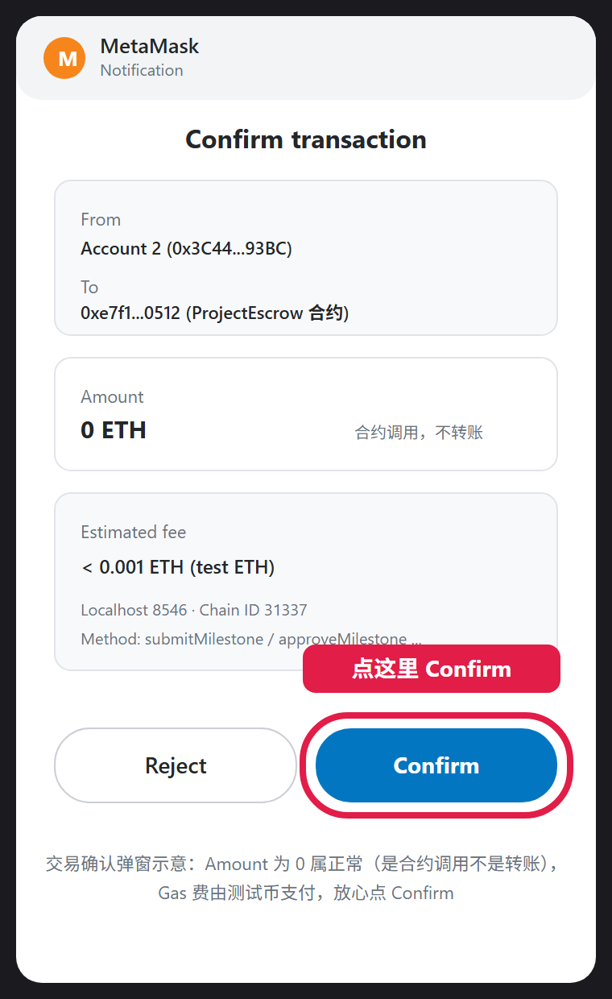
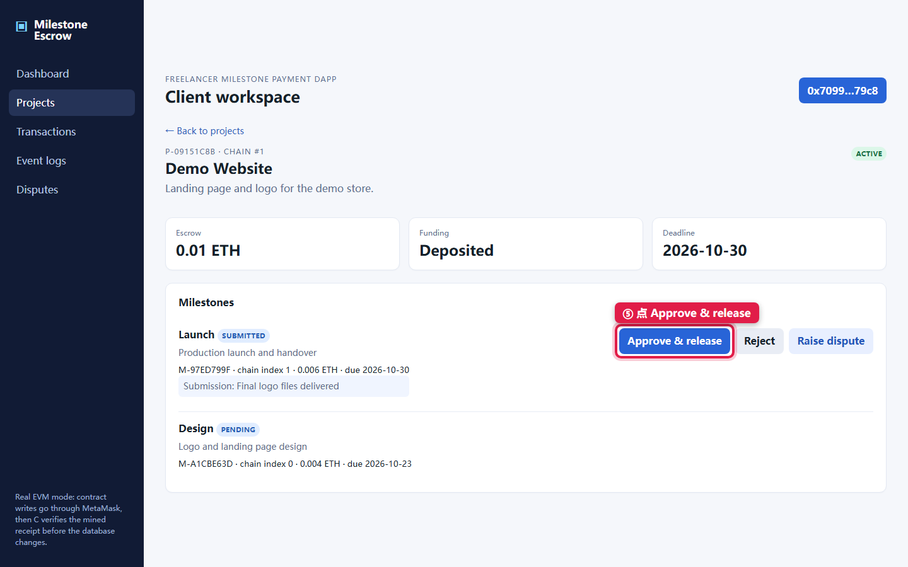
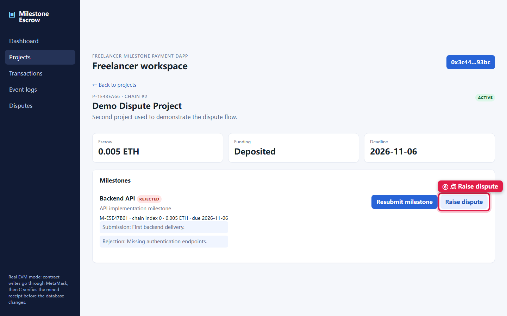
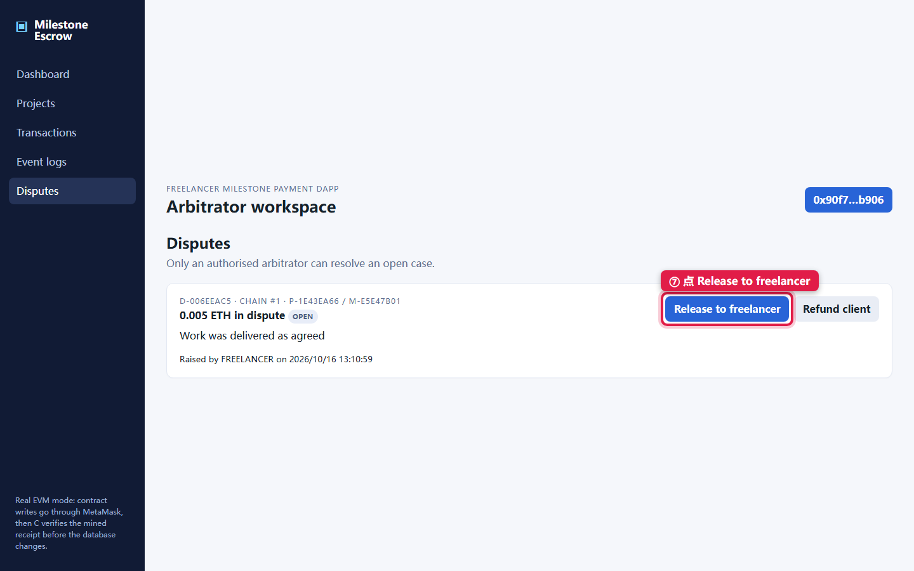
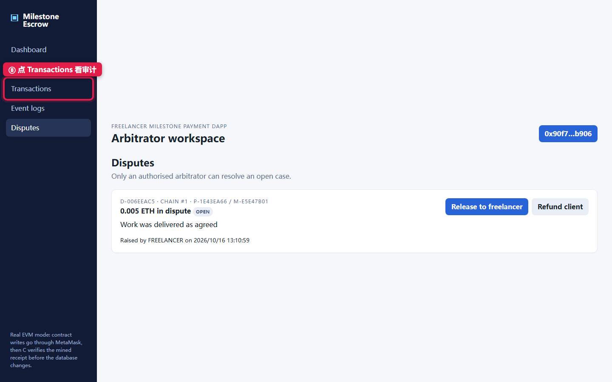

# SC6113 五分钟演示 · 超级手把手版（成员 E）

> 这份文档假设你完全没碰过 MetaMask。每个动作都拆成「鼠标点哪里 → 等几秒 → 屏幕上出现什么字 → 嘴里说什么」。
> 带红框的截图：红框 = 你要点的按钮。带红圈的 MetaMask 示意图：红圈 = 你要点的按钮。
> **重要：本机 8545 端口被别的软件（Ganache）占着，我们项目已全部改用 8546 端口。所有文档里的 8545 都作废，MetaMask 网络也必须填 8546。**

---

## 零、先搞懂你要演示的是什么（1 分钟读完）

- 系统 = 网页（前端）+ 后端 + 一条本地区块链。
- 钱锁在链上的"托管合约"里，**不是**存在任何一方账户里。
- 三个角色 = 三个钱包：甲方（出钱的）、乙方（干活的）、仲裁员（吵架时判的）。切换角色 = 在 MetaMask 里切换账户。
- 你要演示的两段戏：
  - **戏一**：乙方交活 → 甲方点验收 → 合约自动把钱打给乙方（讲"验收即付款、谁也赖不了"）。
  - **戏二**：甲方拒收 → 乙方不服发起争议 → 钱冻结 → 仲裁员判给乙方（讲"纠纷也有规则管"）。

---

## 一、上台前准备（演示当天提前 20 分钟做，按顺序做）

### 准备 1 + 2 合并：双击两个文件（约 2-3 分钟，全自动）

**你的电脑不需要会任何命令。** 打开文件夹 `D:\Documents\qwen-agent\ajBjhW5orS\default\SC6113\D-integration`，里面有 4 个带编号的文件：

**第一步：双击 `2-部署合约并准备数据`**（黑底白字的那个文件图标）。

它会自动做完全部事情：开本地链 → 部署合约 → 把新合约地址写进配置 → 开后端窗口 → 开前端窗口 → 造好两个演示项目。你只需要**看着它跑**，最后看到：

```
 ALL READY! Open http://localhost:5173 in your browser.
```

= 全部成功。这个窗口可以关了。

它跑的过程中会弹出 3 个新窗口（标题写着 SC6113 chain / backend / frontend），**这 3 个窗口整个演示期间都不要关**。

> 没看到 ALL READY 而是看到 FAILED？把整个窗口截图发我，别自己重试。
> 第一次双击可能被 Windows 问"是否仍要运行"→ 点"更多信息"→"仍要运行"。

**（备用）单独双击**：万一演示中某个窗口被你不小心关了，双击对应文件重开即可：
- `1-启动链` = 重开本地链窗口
- `3-启动后端` = 重开后端窗口
- `4-启动前端` = 重开前端窗口
注意：**只要重开过 `1-启动链`，就必须再双击一次 `2-部署合约并准备数据`**（链一重启，合约和数据就没了，这个文件会全部自动重建）。

### 准备 3：配置 MetaMask（5 分钟，只做一次）

**3.0 第一次打开狐狸**（新版欢迎页有三个黑色按钮"使用 Google / Apple / Telegram 继续"——**都不要点**，它们会绑定你的真实账号）。随便用哪种方式先把钱包建起来（创建新钱包或用私钥助记词都行），设密码、助记词提示一律跳过。**建出来的第一个随机账户用不上，别管它。**

**3.0b 导入三个演示账户（关键步骤，唯一可靠的方式）**：
1. 点狐狸面板**左上角账户名旁的下拉箭头** → 列表最下面 **「添加账户或硬件钱包」** → 选 **「使用私钥导入账户」**。
2. 粘贴第一串私钥（整行复制）→ 导入：
   `0x59c6995e998f97a5a0044966f0945389dc9e86dae88c7a8412f4603b6b78690d`
   导入后地址显示 `0x7099…79C8`，**切到 Localhost 8546 网络后余额 = 10000 ETH**（这就是对的标志；余额 0 = 网络没切对或账户不对）。
3. 重复两次，导入：
   - 乙方：`0x5de4111afa1a4b94908f83103eb1f1706367c2e68ca870fc3fb9a804cdab365a`（地址 `0x3C44…93BC`）
   - 仲裁：`0x7c852118294e51e653712a81e05800f419141751be58f605c371e15141b007a6`（地址 `0x90F7…b906`）
4. 给三个账户改名（点账户名旁铅笔✏️）：`0x7099` 开头 = **Client**、`0x3C44` = **Freelancer**、`0x90F7` = **Arbitrator**。最初那个随机账户改名"废弃"，永远不要选它。

**3.1 添加网络**（如果列表里已有"Localhost 8546"就跳到 3.2）：
1. 点浏览器右上角狐狸图标 → 点左上角网络名（可能写着 Ethereum / 以太坊主网）→ `添加网络` → `手动添加网络`。
2. 四个格子这样填：
   - 网络名称：`Localhost 8546`
   - RPC URL：`http://127.0.0.1:8546`
   - 链 ID：`31337`
   - 货币符号：`ETH`
3. 点保存，然后**切换到这个网络**（网络名出现在狐狸窗口顶部）。

**3.2 现在把账户切到 Client**（左上角下拉 → 点地址 `0x7099` 开头那一行，前面出现对勾 = 切好了），并确认网络是 Localhost 8546、余额 10000 ETH。

> 排错：余额显示 0 = ①网络没切到 Localhost 8546，或 ②选中的不是三个导入账户之一。地址对、网络对，余额必然是 10000。

### 准备 4：登录一次（1 分钟）

1. 浏览器打开 `http://localhost:5173`。
2. 看到右上角蓝色按钮 **Connect MetaMask**，点它。
3. 狐狸弹窗出来 → 点 **Connect**（连接请求）。
4. 按钮变成 **Sign in with wallet**，再点它。
5. 狐狸弹窗变成签名请求（长这样，点蓝按钮 **Sign**）：



6. 网页右上角变成 `0x7099…79c8`、标题变成 `Client workspace` = 登录成功。

### 准备 5：上台前 30 秒检查

- [ ] 三个 SC6113 窗口（chain / backend / frontend）都开着、无红字
- [ ] 浏览器开 `http://localhost:3001/health`，页面里有 `"chainMode":"evm"`
- [ ] 网页 Projects 里能看到 **Demo Website** 和 **Demo Dispute Project** 两行
- [ ] MetaMask：网络是 Localhost 8546、账户是 Client
- [ ] 浏览器只留这一个标签页 + 同学 PPT 的标签页

### 准备 6：登录成功后（看到 Client workspace），接下来按顺序做

你现在的状态 = 一切就绪。接下来就是**把第二节的两段戏完整走一遍**（排练），照着下面的顺序一步步做。每一步的详细说明和截图见第二节对应段落，这里只列动作顺序：

**先核对（10 秒）**
1. 点左侧 **Projects** → 确认列表里有 **Demo Website** 和 **Demo Dispute Project** 两行。没有就双击 `2-部署合约并准备数据` 重来。

**戏一：交活 → 验收 → 自动付款（练 1 遍，约 3 分钟）**
2. 切乙方：点狐狸图标 → 左上角账户下拉 → 选 **Freelancer**（`0x3C44…`，余额 10000）。
3. 回网页点右上角蓝色按钮（显示 `Sign in with wallet`）→ 狐狸弹窗点 **签名** → 标题变 **Freelancer workspace**。
4. Projects → 点 **Demo Website** → 对第一个里程碑 Design 点 **Submit milestone**。
5. 弹输入框「Submission note」→ 填 `Final logo files delivered` → 确定；第二个弹框留空 → 确定；狐狸弹窗 → **Confirm**。
6. 盯按钮等四步文案走完 → Design 变 **SUBMITTED**。
7. 切甲方：狐狸选 **Client** → 网页点钱包按钮 → **Sign in with wallet** → 签名。
8. 同一页面点 **Approve & release** → Confirm → Design 变 **APPROVED**（钱已自动付给乙方）。
9. （可选）对第二个里程碑 Launch 重复 4–8，项目会变 **COMPLETED**。

**戏二：拒收 → 争议 → 仲裁（练 1 遍，约 3 分钟）**
10. 切乙方 → 签名登录 → Projects → 点 **Demo Dispute Project**（里程碑已是 REJECTED 状态）。
11. 点 **Raise dispute** → 弹框填 `Work was delivered as agreed` → 确定 → 狐狸 **Confirm** → 项目变 **DISPUTED**。
12. 切仲裁：狐狸选 **Arbitrator**（`0x90F7…`）→ 网页钱包按钮 → 签名登录。
13. 点左侧 **Disputes** → 卡片上点 **Release to freelancer** → 狐狸 **Confirm** → 变 **RESOLVED**。

**收尾（练 1 遍，30 秒）**
14. 切回甲方（或保持仲裁）→ 点左侧 **Transactions** 看一眼 → 再点 **Event logs** 看一眼。

**排练完必须做**：以上操作把两个演示项目都"消耗"掉了（Demo Website 已付款、Dispute 已裁决）。**正式上台前双击一次 `2-部署合约并准备数据`**，等 `ALL READY!`，两个项目恢复初始状态。

**切角色口诀（全流程共 4 次切换，就这一个动作）**：狐狸里选账户 → 网页点右上角蓝色按钮 → 狐狸弹窗点签名。练到不用想为止。

---

## 二、正式演示 · 逐秒操作（照做即可）

### 第 0 段　0:00–0:30　开场

**手上动作**：PPT 讲完 → 切到浏览器 → 点左侧栏 **Projects**（红框①）：



**屏幕上会出现**：两行项目表格：



**嘴上说**（30 秒）：
"这是我们组的里程碑付款系统。钱不放在任何人的账户里，而是锁在区块链的托管合约中。这里有两个已经注资的项目，接下来两分钟我演示两件事：正常验收怎么自动付款，以及出纠纷时仲裁怎么裁。系统有三个角色——甲方、乙方、仲裁员，切换角色就是切换钱包。"

### 第 1 段　0:30–2:10　戏一：交活 → 验收 → 自动付款

#### 动作 1：换成乙方钱包（20 秒）

1. 点狐狸图标 → 点头像 → 点 **Freelancer**。
2. 回网页，点右上角蓝色钱包按钮（红框③，现在显示 `0x7099…79c8`）：



3. 按钮变成 **Sign in with wallet**，点它 → 狐狸签名弹窗 → 点 **Sign**（见准备 4 的图）。
4. 网页标题变成 `Freelancer workspace`、右上角变 `0x3c44…93bc` = 切换成功。

**嘴上说**："现在我是乙方。"

#### 动作 2：乙方提交成果（50 秒）

1. 点列表里的 **Demo Website**（红框②那张图里的项目名）。
2. 进入详情页，找到第一个里程碑 **Design**，点右边的 **Submit milestone**（红框④）：



3. 浏览器弹一个小输入框，标题 `Submission note` → 输入 `Final logo files delivered` → 点确定（OK）。
4. 又弹一个输入框 `Evidence URL` → **什么都不填**，直接点确定。
5. 狐狸弹窗出现（交易确认，长这样）→ 点蓝按钮 **Confirm**：



> 弹窗里 Amount 是 0 ETH 属正常——这是"调用合约"不是"转账"。Gas 费用测试币付，不花真钱。

6. **盯住按钮等 5~10 秒**，它依次变成：`Transaction submitted…` → `Waiting for blockchain confirmation…` → `Recording and verifying with backend…` → `Recorded successfully.`
7. Design 里程碑旁边出现蓝色小标签 **SUBMITTED**，下面多出你写的那句话 = 成功：


**嘴上说**："乙方提交成果。注意：提交内容的哈希先写进链上交易，后端再回链上核验这笔回执，核验通过才入库。现在状态是 SUBMITTED，等甲方验收。"

#### 动作 3：甲方验收 = 自动付款（50 秒）

1. 狐狸切到 **Client** → 网页点右上角钱包按钮 → **Sign in with wallet** → 狐狸弹窗 **Sign**。
2. 还停在 Demo Website 页面（如果跳走了：点左侧 Projects → 点 Demo Website）。
3. 对 Design 里程碑点 **Approve & release**（红框⑤）：



4. 狐狸弹窗 → **Confirm** → 盯按钮等它走完四步文案。
5. Design 变成绿色标签 **APPROVED**：


**嘴上说（全场最重要的一句话，放慢）**："甲方点验收的这一刻，托管合约**自动**把 0.004 个 ETH 从托管里转给乙方。是合约执行的，不需要任何人手动转账，甲方也没法点了验收又赖账。这就是整个系统的核心。"

### 第 2 段　2:10–4:00　戏二：拒收 → 争议 → 仲裁

#### 动作 4：乙方发起争议（60 秒）

1. 狐狸切 **Freelancer** → 网页点钱包按钮 → **Sign in with wallet** → **Sign**。
2. 点左侧 **Projects** → 点 **Demo Dispute Project**。
3. **屏幕上**：里程碑 Backend API 是红色标签 **REJECTED**，下面有行小字 `Rejection: Missing authentication endpoints.`（剧情：乙方交过活、甲方拒收了）：


4. 点 **Raise dispute**（红框⑥）：



5. 弹输入框 `Dispute description` → 输入 `Work was delivered as agreed` → 确定。
6. 狐狸弹窗 → **Confirm** → 盯按钮等四步文案走完。
7. 项目右上角和里程碑都变成 **DISPUTED**：


**嘴上说**："第二个项目是纠纷剧本：乙方交付后甲方拒收。乙方不服，在链上发起争议。看状态——DISPUTED，这笔钱现在被合约**冻结**：甲方拿不回去，乙方也取不出，只能等仲裁。"

#### 动作 5：仲裁员裁决（60 秒）

1. 狐狸切 **Arbitrator** → 网页点钱包按钮 → **Sign in with wallet** → **Sign**。
2. 点左侧 **Disputes**。
3. **屏幕上**：一张争议卡片，写着金额、OPEN、你的争议描述，下面两个按钮（红框⑦）：



**先说话再点**："仲裁员看到未决争议，只有两个选择：判乙方赢就放款给乙方，判甲方赢就退款。合约只认仲裁员这个角色，甲乙双方谁都动不了这笔冻结的钱。现在我判乙方赢。"

4. 点 **Release to freelancer** → 狐狸弹窗 → **Confirm** → 等四步文案。
5. 卡片变成 **RESOLVED**，显示 `Resolution: RELEASE_TO_FREELANCER`：


**嘴上说**："裁决上链，合约立刻执行放款，争议关闭。谁在什么时候裁的、钱去了哪，链上永久可查，谁都改不了。"

### 第 3 段　4:00–5:00　收尾

#### 动作 6：展示审计页（30 秒）

1. 点左侧 **Transactions**（红框⑧）：



2. **屏幕上**：每行一笔链上交易（类型、钱包、金额、哈希）：


3. 再点左侧 **Event logs**，每行一条解码后的链上事件：


**嘴上说**："这两页是审计视图。每一行都对应真实的链上交易和事件——不是数据库随便记的，后端是先核验链上回执才落库。"

#### 动作 7：总结（25 秒，背这句）

"总结架构：前端发起、MetaMask 签名上链；合约是资金和规则的唯一权威；后端只做回执核验和链下存储。付款、冻结、裁决都由合约强制执行，没有任何一方能绕过规则。我的演示到此结束，谢谢。"

---

## 三、翻车急救（出问题先查这张表，别慌）

| 你看到的 | 30 秒内怎么做 |
|---|---|
| 点按钮后狐狸没弹窗 | 点一下狐狸图标，看有没有排队请求，手动点 Confirm/Sign |
| 按钮卡在 `Waiting…` 超过 15 秒 | 再等 10 秒；提示 confirmations 字样就按页面提示点重试 |
| 狐狸报 nonce 错误 | 狐狸 → Settings → Advanced → Clear activity tab data → 回网页重点一次该按钮 |
| 网页顶部黄条 Wrong chain | 狐狸顶部网络名切回 `Localhost 8546` |
| 登录后黄条"must have an on-chain role" | 你切错账户了，必须是 Client/Freelancer/Arbitrator 三个之一 |
| 红条 backend unavailable | 后端窗口挂了：双击 `3-启动后端` 重开，等 10 秒刷新网页 |
| 列表空空的 | 链或后端挂了，或数据被排练消耗：**直接双击 `2-部署合约并准备数据` 重来一次**（全自动，2 分钟） |
| 手滑点错按钮 | 别救，顺着讲：Reject 本来就是戏二剧情的一部分 |
| 彻底救不回 | 说"下面用截图过一遍流程"，按 `docs/shots/` 里 01→17 的顺序翻图讲，每张图对应上面某一步 |

**演示前绝对不要**：关三个 SC6113 窗口、删改 `backend\data` 文件夹、在 Demo Website 上点 Reject、在 Demo Dispute Project 上点 Resubmit、把 MetaMask 切到别的网络。

**排练过一次之后**：数据被消耗了，正式上台前**双击一次 `2-部署合约并准备数据`** 即可全部重建（看到 ALL READY 就行）。

---

## 四、前一天排练清单

1. 双击 `2-部署合约并准备数据`，看到 ALL READY 后，确认 Projects 里有两行项目。
2. 掐表走一遍第二节，目标 4 分半（留 30 秒缓冲）。
3. 单独练 4 次"切钱包+登录"（Freelancer→Client→Freelancer→Arbitrator）：狐狸点头像→选账户→回网页点钱包按钮→Sign in with wallet→Sign。全流程就这一个动作重复四次，练到不用想。
4. 把两段"嘴上说"用自己的话讲顺，保住四个关键词：**托管、核验回执、冻结、只有仲裁员能裁**。
